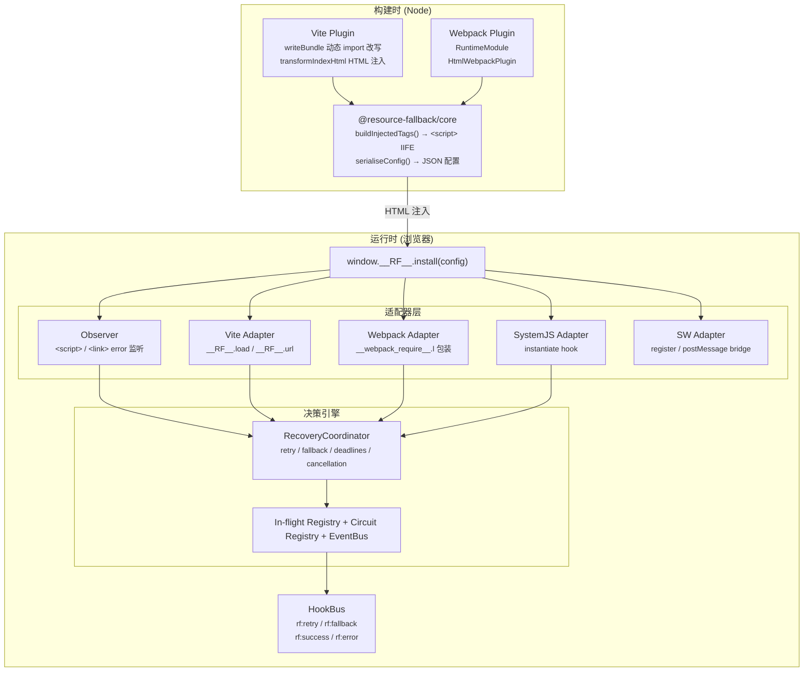
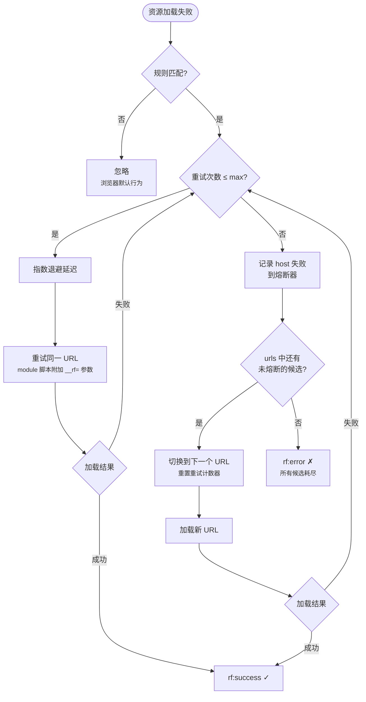

# 工作原理

构建器适配器保留加载语义，页面 Coordinator 统一恢复决策；SW 在独立上下文处理受管子资源。

## 核心架构总览

### 回退流程

## 包结构

| 包                                                                                                     | 说明                                 | 版本信息                   |
| ------------------------------------------------------------------------------------------------------ | ------------------------------------ | -------------------------- |
| [`@resource-fallback/core`](https://www.npmjs.com/package/@resource-fallback/core)                     | 浏览器 IIFE 运行时 + Node 端工具函数 | 见 npm 页面 / package.json |
| [`@resource-fallback/vite-plugin`](https://www.npmjs.com/package/@resource-fallback/vite-plugin)       | Vite 4+ 插件                         | 见 npm 页面 / package.json |
| [`@resource-fallback/webpack-plugin`](https://www.npmjs.com/package/@resource-fallback/webpack-plugin) | Webpack 5+ 插件                      | 见 npm 页面 / package.json |

### @resource-fallback/core

核心运行时与构建工具：

- **RecoveryCoordinator** — 页面侧恢复决策引擎，统一负责规则选择、retry / fallback、deadline、取消与事件
- **Retry** — 指数退避 + 抖动
- **Circuit Registry** — per-host 熔断状态；页面侧当前只有一个 registry，支持 localStorage 跨 Tab 共享
- **Observer** — 监听 `<script>` / `<link>` 的 error 事件
- **Adapter** — Vite / Webpack / SystemJS / SW 适配器，负责 transport 与 ownership 接入
- **buildInjectedTags()** — 生成注入 HTML 的标签
- **getRuntimeCode()** — 获取 IIFE 运行时源码

### @resource-fallback/vite-plugin

Vite 构建集成，详见 [Vite 集成](../guide/vite.md)：

- `transformIndexHtml` HTML 注入
- 动态 `import()` 包装
- 可选 Hybrid SW 资产生成

当前页面 runtime 还有三个需要明确的限制：

- `window.__RF__.url(filename)` 只会使用第一条已编译规则的 `base` 构造首轮 URL，不会跳过已熔断 host；
- 规则会先按 `base` 长度降序编译；恢复开始后，RecoveryCoordinator 会根据初始 URL 选中一条规则，并沿该规则的有序候选继续恢复；
- 页面侧目前只初始化一个 circuit registry，而不是每条规则各自一个。

### @resource-fallback/webpack-plugin

Webpack 构建集成，详见 [Webpack 集成](../guide/webpack.md)：

- `RuntimeModule` 注入，patch `__webpack_require__.l`
- `html-webpack-plugin` 集成 HTML 注入
- 可选 Hybrid SW 资产生成
